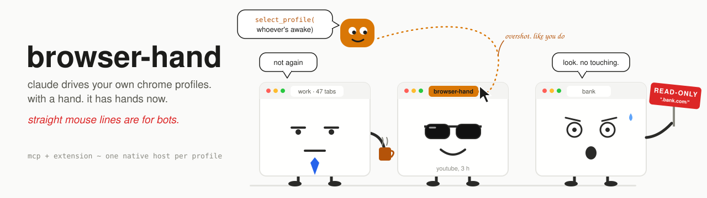

<picture>
  <source media="(prefers-color-scheme: dark)" srcset="assets/banner-dark.svg">
  <source media="(prefers-color-scheme: light)" srcset="assets/banner-light.svg">
  
</picture>

# browser-hand

claude drives your own chrome profiles ~ and moves the mouse like it has hands.

It's a local MCP server plus a Chrome extension. Claude Code picks one of your
profiles (logins already in place), reads pages, and clicks, types and scrolls
the way a person does. Nothing leaves your machine.

- **Your real profiles.** `list_profiles`, then `select_profile`. Work, personal, whatever's signed in.
- **Human-shaped input.** Curved cursor paths with overshoot, held clicks, typing with real gaps. Pages get trusted events.
- **Fences.** Blocked sites can't load in Claude's tabs. Read-only sites can be read but not clicked. Claude works in its own tab group and can't touch your other tabs.
- **Record and replay.** Record your own steps from the toolbar popup, then ask Claude to do them again.

> Unofficial. Not made by or affiliated with Anthropic. Modelled on Claude in
> Chrome, with profiles in place of a connected-browser list.

## Status

No release yet, so it's build-from-source for now. macOS and Linux are
tested. Windows compiles and has never run on a real Windows machine ~
see [docs/testing.md](docs/testing.md). Works with Google Chrome, Chromium,
Edge, Brave and Vivaldi.

## Quickstart

You need Rust 1.88+, Node, a Chromium browser and Claude Code.

```sh
git clone https://github.com/izam-mohammed/browser-hand.git
cd browser-hand
sh scripts/build.sh
```

That builds the host and the extension, then registers the native host with
each installed browser. It writes one file outside the repo per browser, and
`plugin/server/browser-hand install --uninstall` removes it.

Load the extension once per profile Claude may use: open `chrome://extensions`,
turn on **Developer mode**, **Load unpacked**, pick `extension/dist`. After
that, every `sh scripts/build.sh` reloads it for you.

Then start Claude Code with the plugin, which brings the server and a skill:

```sh
claude --plugin-dir "$PWD/plugin"
```

Or add only the server:

```sh
claude mcp add --scope user browser-hand -- "$PWD/plugin/server/browser-hand" mcp
```

Try it:

> list my chrome profiles, pick the personal one, and open example.com

On Windows `scripts/build.sh` doesn't run. The steps are in
[getting started](docs/book/src/getting-started.md).

## How it fits together

```text
Claude Code --stdio--> browser-hand mcp --unix socket--> browser-hand (native host) --native port--> extension
```

Chrome starts one native host per profile that has the extension. The MCP
server finds them and talks to the one for the profile you selected, opening
that profile if it isn't open. The wire format is [docs/protocol.md](docs/protocol.md).

## Tools

| Tool | What it does |
| --- | --- |
| `list_profiles`, `select_profile` | Your profiles, and binding the session to one |
| `tabs_context`, `tabs_create`, `tabs_close` | The session's own tab group |
| `navigate` | Open a URL, or go back or forward |
| `read_page`, `find`, `get_page_text` | The page as roles and refs, elements by plain words, the article's text |
| `read_console_messages`, `read_network_requests` | Console output and requests |
| `computer` | Mouse, keyboard and screenshots, moving like a person |
| `form_input`, `file_upload`, `upload_image`, `javascript_tool` | Fill fields, upload files, run JavaScript |
| `browser_batch`, `resize_window` | Several calls in one trip, window size |
| `gif_creator` | The session's actions as an animated GIF |
| `recording_list`, `recording_get`, `recording_delete`, `recording_replay` | Steps you recorded in the popup |

Every argument and result: [tools reference](docs/book/src/reference/tools.md).

## Settings

Toolbar button, then **Settings**. It sets pace (Human or Fast), typing and
mouse speed, the default profile, blocked and read-only sites (patterns like
`*.bank.com/*`), screenshot and GIF options, and the debugger idle timeout.
They're saved to `~/.config/browser-hand/config.toml` and every open profile
picks a change up within 2 seconds. Details: [settings reference](docs/book/src/reference/settings.md).

Blocked sites are enforced by the extension. Read-only is enforced too, but
nothing stops a Bash command from editing the settings file, so keep that in mind.

## Docs

- [getting started](docs/book/src/getting-started.md) and the [guides](docs/book/src/guides)
- [examples](docs/book/src/examples.md)
- [troubleshooting](docs/book/src/guides/troubleshooting.md)
- [how "humane" input works](docs/research/humane-input.md)

## Development

```sh
make check   # format, lint, types, tests, release build, advisories, secrets
```

`make lint`, `make test`, `make coverage` and `make security` run one part
each. `docs/standards.md` lists every check and what it needs installed
(`gitleaks`, `osv-scanner`), and `docs/testing.md` covers the suites and the
headless Chrome proofs in `scripts/prove/`.

Found a security problem? See [SECURITY.md](SECURITY.md).

## License

MIT, see [LICENSE](LICENSE).
